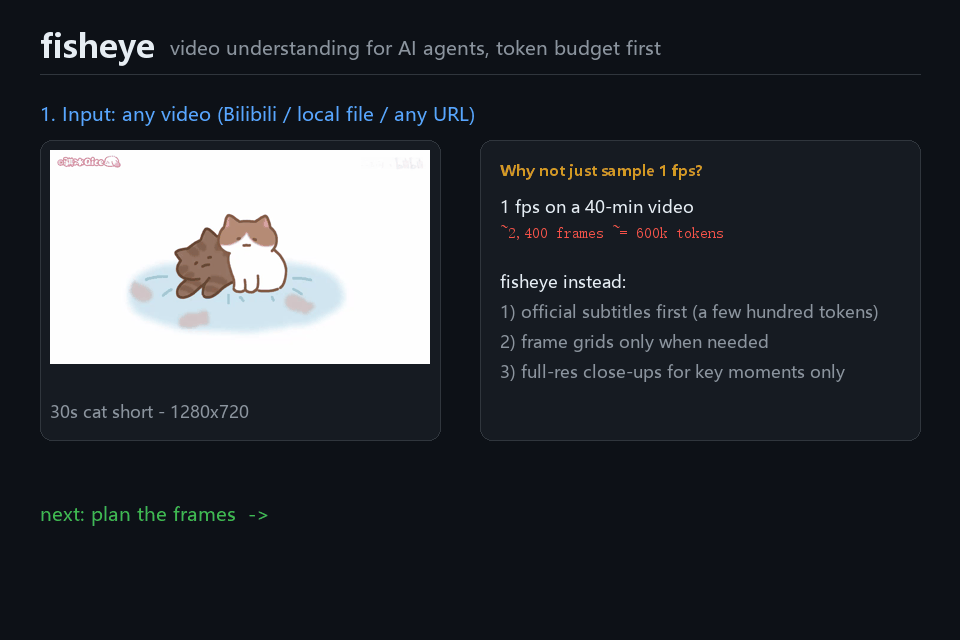

# fisheye · tokencut

[English](./README.en.md) | [中文](./README.md)

> Let AI agents *see* videos on a token budget — **tokencut** the token cost of video understanding, instead of grabbing one frame every 10 seconds.

A CLI that **understands a video within a token budget** — whether it comes from Bilibili, a local file, or any URL.

```bash
node fisheye.mjs auto BV1xxx --budget 20000          # Bilibili
node fisheye.mjs auto video.mp4 --budget 20000       # local file
node fisheye.mjs auto https://... --budget 20000     # any URL (yt-dlp)
```

One `auto` command handles every platform: it detects the input type and routes to the matching platform adapter.

---



## Why

The naive way to let an AI watch a video is one frame per second — but real videos do not need a frame every second. Here are measurements on five real videos (budget 20000):

### Measured input tokens across video types (budget 20000)

"Input" = the evidence fisheye hands to the model (subtitles + grids + close-up reserve). "1 fps baseline" = one frame per second at ~250 tokens each.

| Video (type) | Duration | Subtitles | Grids | Close-up reserve | **Input total** | 1 fps baseline | Saved |
|---|---|---|---|---|---|---|---|
| Wake up, honey (animation) | 30s | zh 52 | 1×1024 | 2048 | **3,124** | ~7,500 | 2.4× |
| iPhone Duo review (tech) | 130s | en 2,288 (zh 689) | 2×1024 | 2048 | **6,384** | ~32,500 | 5× |
| Lima (stop-motion) | 856s | band 139 | 8×1024 | 2048 | **10,379** | ~214,000 | 21× |
| Organization 54 (history) | 2255s | en 49,757 (zh 11,615) | 1×1024 | 2048 | **52,829** | ~563,750 | 11× |
| Flagship chip roundup (long tech) | 3435s | zh 18,340 | 1×1024 | 2048 | **21,412** | ~858,750 | 40× |

**Subtitle track matters (same 2255s history video)**

| Track | Subtitle tokens | + grids 1024 + close-ups 2048 | Total | Within a 20k budget? |
|---|---|---|---|---|
| English AI track (original) | 49,757 | +3,072 | **52,829** | ❌ 2.6× over |
| Bilibili Chinese translation track | 11,615 | +3,072 | **14,687** | ✅ fits |

**Output tokens**: fisheye does not write summaries (that is the calling model's job) — the model writes roughly **300–800 tokens** from the input above; that does not consume fisheye's budget.

**Takeaways**

- Input tokens are dominated by duration × subtitle density; grids and close-ups are fixed overhead.
- Picking the right subtitle track changes cost by **3.5×** (54k English original → 15k Chinese translation).
- vs the 1 fps baseline, fisheye saves **2× to 39×** (little on short clips, a lot on long ones).

## Core idea: multiple information sources

Not everything needs to be read as images. Sources are ranked by "information per token" — save what can be saved first:

| Priority | Source | Cost | When |
|---|---|---|---|
| ① | **Official subtitles** (CC track, prefer the AI Chinese one) | hundreds – tens of thousands of tokens | when the video has subtitles — text is an order of magnitude cheaper than pixels |
| ② | **Burnt-in subtitle band** (subtitles baked into the picture) | ~1024 tokens | no official subtitles, but text sits at the bottom of the frame |
| ③ | **Danmaku hotspots** (audience reaction, Bilibili) | ~100 tokens | find the moments the audience reacted to — **invisible to both frames and subtitles** |
| ④ | **Frame grids** (3×3) | 1024–1024 tokens/grid | fallback: when pixels actually matter |
| ⑤ | **Semantic shifts** (topic change points, optional) | zero tokens | where the video changes topic/segment, feeding refine suggestions |

Then a few key moments get a **close-up** (a single full-resolution frame) — the only place we spend big.

## Install

> **Let your agent install it**: paste this repo link (or this README) to your AI agent and say "install fisheye, then run selftest". Setup steps, dependency probing and repair hints all live in this README and in `selftest` output, so the agent can finish the whole flow on its own; if any `[!!]` item shows up, it just installs the missing dependency and reruns.
>
> Why this works well: the core has zero npm dependencies, `selftest` diagnoses each piece with concrete repair commands, and errors carry the next executable step.

**Requires**: Node.js 18+, ffmpeg

**Optional**: Python 3.9+ (with `fastembed` + `ruptures`, for the semantic embedding enhancement; without it fisheye automatically falls back to the pure-JS lexical cut); whisper.cpp (audio transcription); tesseract (OCR); yt-dlp (any URL)

```bash
# Option 1: npm global install (recommended)
npm i -g @pls-compile-owo/fisheye

# Option 2: from source
git clone https://github.com/pls-compile-owo/fisheye
cd fisheye
npm link   # optional: install as a global command
```

### macOS (Apple Silicon / Intel)

```bash
brew install node ffmpeg python3
brew install whisper-cpp                 # optional: transcription (the arm64 artifact may be named whisper-cpp-darwin-arm64; fisheye discovers it by prefix)
brew install tesseract tesseract-lang    # optional: OCR
pip3 install --user yt-dlp               # optional: any URL
pip3 install -r semantic/requirements.txt # optional: semantic segmentation
```

**Subtitle-band detection**: pure JS now (`lib/band.mjs`), zero Python / zero numpy-Pillow, no Python dependency at all.

**Semantic segmentation**: the default is the pure-JS lexical fallback (`lib/semantic-core.mjs`, zero dependencies); the embedding enhancement (bge-small-zh-v1.5, more accurate) needs Python:

```bash
python3 -c "import fastembed, ruptures"   # selftest verifies with the same interpreter; missing deps degrade to pure JS
```

**Unzipping**: a Windows-made zip may unzip into backslash-named broken files on macOS. Prefer `npm i -g`, or the `.tgz` produced by `npm pack` (POSIX path safe).

### Bilibili credentials (only needed for Bilibili)

Copy `credentials.example.json` to `credentials.json` and fill in three values:

```json
{
  "sessdata": "<your SESSDATA>",
  "bili_jct": "<your bili_jct>",
  "buvid3": "<your buvid3>"
}
```

How to get them: log in to Bilibili in a browser → F12 → Application → Cookies → `bilibili.com`, copy these three fields.

> ⚠️ This file is excluded by `.gitignore`, **never commit it**. Local files / URLs need no login.

### Environment variables

| Variable | Meaning |
|---|---|
| `FISHEYE_LANG` | CLI language: `zh` (default) / `en` |
| `FISHEYE_TOKENS_PER_GRID` / `FISHEYE_TOKENS_PER_SUBS` / `FISHEYE_TOKENS_PER_FINE` | token estimate overrides per grid / subtitle band / close-up (default 1024 / 1024 / 1024) |
| `FISHEYE_TOKEN_MODEL` | correct estimates by tokenizer: `gpt` (1.08) / `qwen` (1.27) / `gemini` (0.25) / `claude` (1.56) / a number |
| `FISHEYE_VISUAL_TRACK` | visual authorization tier: `on` / `ask` (default) / `off` |
| `FISHEYE_LOW_ACTIVITY_WEIGHT` | low-activity down-weight (default 0.3, render algorithm track only) |
| `FISHEYE_WHISPER` / `FISHEYE_WHISPER_MODEL` | whisper executable / model (ggml-*.bin, optional) |
| `FISHEYE_HOME` | data directory (where cache/out live, default: project directory) |
| `SEMANTIC_CLI` / `SEMANTIC_PYTHON` | semantic CLI / the Python that runs it (default: bundled `semantic/cli.py`) |
| `FISHEYE_MIN_SCENE` / `FISHEYE_MAX_PICKS` | refine geometry thresholds: min scene intensity (default 0.85) / max picks (default 8) |
| `FISHEYE_TESSERACT` / `FISHEYE_YTDLP` | OCR / yt-dlp executable paths (optional capabilities; also searched on PATH and common install locations) |
| `FISHEYE_AUTO_AUDIO` | set to `0` so `auto` stops trying whisper transcription (same as `--no-audio`) |
| `FISHEYE_TRACE` / `FISHEYE_DEBUG` | debugging: `FISHEYE_TRACE=1` writes `out/<id>-trace.json` (per-stage timings); `FISHEYE_DEBUG=1` prints stacks |
| `FFMPEG` / `PYTHON` / `BILI_CRED` | tool and credential path overrides |

### Dependency paths (usually nothing to do)

fisheye finds ffmpeg / python / credentials in this order:

```
environment variables (FFMPEG / PYTHON / BILI_CRED)
  → ~/.config/fisheye/config.json
  → bin/ and credentials.json inside the project
  → PATH
```

Only when nothing is found does it fail, and it prints the repair command directly. You can also write the config by hand:

```json
// ~/.config/fisheye/config.json
{
  "ffmpeg": "C:/tools/ffmpeg/bin/ffmpeg.exe",
  "python": "C:/Python312/python.exe",
  "credentials": "D:/secrets/bili.json"
}
```

## Quick start

```bash
# 1. self-check first (a second or so; confirms deps/credentials/APIs)
node fisheye.mjs selftest

# 2. plan and lay out the grids (Bilibili / local / URL all work)
node fisheye.mjs auto BV1ziWP6qENy --budget 20000
node fisheye.mjs auto video.mp4 --budget 20000
node fisheye.mjs auto "https://www.bilibili.com/video/BV1ziWP6qENy" --budget 20000

# 3. look at the grids in out/, or read the manifest to decide on close-ups
node fisheye.mjs refine BV1ziWP6qENy

# 4. close-ups: grab full-resolution single frames
node fisheye.mjs grab BV1ziWP6qENy 82.5,145.0
```

### Common flags

```bash
--budget 20000          # token budget (decides the grid-count cap)
--from 1:30 --to 3:00   # only a segment
--density 6             # force 6 s/frame (overrides the automatic derivation)
--no-danmaku-frames     # danmaku hotspots do not participate in frame picking
--p 2                   # page 2 of a multi-page video
--no-audio              # do not try whisper when there are no official subtitles
```

## Output

`auto` (2.0 default fast mode) produces **text evidence only — no images** (iron law: no render by default):

| File | Content |
|---|---|
| `<id>-manifest.json` | **structured index** (`schemaVersion: 2`): segment cards (skeleton / danmaku emotion / low-activity / needs-frames) + evidence availability + quote + `visualRequest` |
| `<id>-plan.json` | per-segment plan (cards + frame costs), consumed by `render --plan` |
| `<id>-report.html` | human self-check (overview / evidence / segment list / rationale) |
| `<id>-official-subs.txt` | full official subtitles with timestamps; plus `-official-subs-plain.txt` as plain text |
| `<id>-official-subs-translated.txt` | official Chinese translation track (when the video has one) |

Render images on demand (nothing is written to disk otherwise):

```bash
node fisheye.mjs render <BV|file|URL> --track coarse        # whole video, 4 min/frame, 1–2 grids
node fisheye.mjs render <BV|file|URL> --track algorithm --segments 3,7   # 9 frames/segment + snap + down-weight
node fisheye.mjs render <BV|file|URL> --track adaptive       # density by video type (both sources low-confidence)
```

`<id>` is a stable "filename-safe" identifier: Bilibili = BV id, local = file basename, URL = hash of the normalized URL.

Terminal output goes to stderr (stdout carries only `MANIFEST:` / `PLAN:` / `REPORT:` paths for agent redirection), e.g.:

```
[subs] official Chinese translation 1088 lines / 11615 chars (translation track preferred, 3.5× cheaper)
[low-activity] 2 danmaku density valleys (low engagement, not necessarily ads):
        05:20-07:40 (140s)  sample "已下单，未付款，盼发货"
[ad-keywords] 3 hits (pure hints, judgment stays with the agent)
[danmaku] 3580 comments, audience peaks:
        14:50   43 comments  "吓哭了×10" "将自然哲学理论偷换成政治观念了"
[semantic] 5 topic shifts
=== done (fast text mode, nothing rendered) ===
text only ≈ 1298 tokens (10 segment skeletons)
MANIFEST: .../BVxxx-manifest.json
PLAN: .../BVxxx-plan.json
REPORT: .../BVxxx-report.html
```

### Artifact completeness summary

After `auto` / `local --smart`, one line says what each source actually produced:

```
[artifacts] subs✓1026 · danmaku✓3580 · lowActivity✓2 · semantic✓5 · transcript— · band—
```

Marks: `✓` obtained / `△` poor quality / `○` skipped / `—` none. The same structure goes into the manifest's `coverage` field — agents no longer have to infer silent degradation from logs.

## Commands

| Command | Purpose |
|---|---|
| `auto <BV\|file\|URL>` | recommended entry: fast text mode (segment cards + skeleton + danmaku, <5s, no images); `--standard` for full collection + grids |
| `render <BV\|file\|URL>` | lazy render from `plan.json` (`--track coarse\|algorithm\|adaptive\|lowconf`, `--segments N,M`) |
| `grid <BV>` | grids only (`--chunk` seconds per segment, `--grid` e.g. 3x3) |
| `subs <BV>` | subtitle band only (`--count` lines, `--band auto\|0.22`) |
| `refine <BV>` | pick moments worth a close-up, **and grab them** (template / decisions file / geometric fallback) |
| `grab <BV> <t1,t2>` | grab full-resolution single frames at given times |
| `local <video file>` | local shortcut: fast uniform frames into one grid; add `--smart` for the full collection (= `auto <file>`) |
| `transcribe <BV>` | audio transcription (whisper.cpp, `--lang zh`) |
| `ocr <image>` | OCR an image (tesseract, `--lang chi_sim+eng`) |
| `url <link>` | URL shortcut: fast grab; add `--smart` for full collection (= `auto <link>`) |
| `batch <list file\|items...>` | batch processing (`--concurrency N`) |
| `clean [--target cache\|out\|all] [--yes]` | clean cache/output (dry-run by default) |
| `selftest [--deep]` | self-check: dependencies / platform adapters / APIs / OCR / transcription / yt-dlp / semantic / cache / disk |

> `grid` / `subs` / `refine` / `grab` require `cache/<id>.mp4` to exist — run `auto` first (it downloads).

### Parameter ranges

| Parameter | Range | Default |
|---|---|---|
| `--budget` | 2000 ~ 200000 | 20000 |
| `--density` | 0.5 ~ 60 (seconds per frame) | auto, derived from change rate |
| `--p` | 1 ~ 200 | 1 |
| `--chunk` (grid) | 1 ~ 3600 (seconds) | derived from grid count |
| `--count` (subs) | 1 ~ 50 (lines) | auto |
| `--grid` (grid) | 1 ~ 9 rows and columns | 3x3 |
| `--band` (subs) | 0 ~ 0.6 (relative height) | auto |
| `--concurrency` (batch) | 1 ~ 8 | 1 |

### Three ways to pick close-ups (refine)

| Way | Basis | Cost |
|---|---|---|
| `--template` | generate a template; the model reads the grids and fills in "which cells are unclear" | already paid (when reading the images) |
| `--decisions <file>` | grab frames per the model's structured decisions | already paid |
| no flags | **geometric fallback**: scene-change strength ≥0.85 + danmaku hotspots | 1024 tokens per picked moment |

> `refine` lists the moments and then grabs them directly. To only see suggestions, use `refine --template` — it writes the template and grabs nothing.

> Geometric rules can only find "where the picture changes violently" — they cannot find "where there is text". The latter requires actually reading the images. That is a design boundary, not a bug.

## Platform adapters

The core knows no specific platform. Each platform is an "adapter" following one contract (`meta` / `media` / `subtitles` / `danmaku` / `adDetector`):

| Adapter | Input | Capabilities |
|---|---|---|
| `bilibili` | BV id | official subtitles + danmaku + download + ad detection (danmaku family) |
| `local` | local file path | frames directly; subtitles via transcription / burnt-in band fallback |
| `url` | http(s) link | yt-dlp download, then like local |

Adding a platform = copy a directory from `lib/platforms/_template/` + one import line in the registry, without touching the core. **Static registration + directory convention** (not hot-pluggable): fisheye is a local CLI and platforms ship with the package.

## Tuning and extension points

Every "judgement" in fisheye has parameters — tune them for your platform/model/material:

### Ad detection (two signals)

Ad detection was cut from 1.0.29's "seven signals" to **two** (`lib/signals/`; 0.1 verified: the other five contribute zero independent hits, two-signal recall = seven-signal = 100%):

| Output | Source | Meaning |
|---|---|---|
| `lowActivitySegments` | danmaku density valleys | low-activity spans (affects framing: algorithm track down-weights w=0.3) |
| `adKeywordHits` | ad-keyword matching | pure hints (no decision impact; deduped, ≤50) |

Platforms only declare "what ad-keyword evidence they can offer" (`adDetector.adKeywords`), not "which signals to use":

```js
adDetector: {
  adKeywords: AD_KEYWORD,   // regex (sponsor / merch / order / discount / ...)
}
```

Platforms without danmaku (local/URL) use `adDetector: null` — no ad detection (design 05 §7.5). A fully custom detect function is also supported (`({ danmaku, duration }) => [{ from, to, lowDensity, sample }]`).

> **Why cut**: judging "is it an ad" is the agent's job. fisheye only gives "low-activity spans (viewers don't engage)" + "ad-keyword highlights (hints)", and the agent decides from the originals. Down-weight (w=0.3) rather than skip: a false positive only down-weights (recoverable), while skipping deletes a whole span (catastrophic).

### Danmaku filtering (your own slang and ad-link words)

`danmaku-filter.mjs` drops ad-link spam: edit the `AD_RULES` table (ad-link words) for your platform's slang; noise is judged by `spamReason()` (pure symbols / repetition / meaningless short phrases). The rules have their own test: `node test-danmaku-filter.js` (51 cases). `--no-danmaku-frames` keeps danmaku for hotspot/low-activity judgement only, without frame participation.

### Budget model (calibrate to your tokenizer)

Token estimates use per-source unit prices, each overridable:

| Constant | Default | Meaning |
|---|---|---|
| `FISHEYE_TOKENS_PER_GRID` | 1024 | one 3×3 grid |
| `FISHEYE_TOKENS_PER_SUBS` | 1024 | one subtitle band |
| `FISHEYE_TOKENS_PER_FINE` | 1024 | one close-up frame (a 5x5 also counts as one image, same as coarse) |
| `FISHEYE_TOKEN_MODEL` | 1.0 | model factor (`gpt` 1.08 / `qwen` 1.27 / `gemini` 0.25 / `claude` 1.56 / custom number) |

> 2.0 pricing: DeepSeek Flash vision caps at **1024 tokens/image** (resized to ~1300×1300, independent of the source dimensions). Old constants 1200/3800 are deprecated.

### Frame density (manual or adaptive)

- Default: derived from the content change rate (0.05–2/s → 4/6/9/13 s per frame)
- `--density N`: force N seconds per frame (0.5–60)
- Hard cap `MAX_GRIDS = 12` (prevents long videos from ballooning)
- Under budget pressure it degrades automatically and explains it in the log ("density needs 20 grids, budget allows 3 → using 3")

### Semantic segmentation (bring your own model)

The semantic module is an **independent external CLI** that can be replaced entirely:

```bash
SEMANTIC_CLI=/path/to/my-semantic-cli.py SEMANTIC_PYTHON=/path/to/python fisheye auto BV1xxx
```

Contract (see the header of `semantic/cli.py`):

```
input:  stdin or first argument is a JSON file: [{ "t": seconds, "text": "line" }, ...]
call:   python cli.py <input.json> [--n-bkps 5]
output: stdout JSON { "segments": [{ "t": s, "confidence": 0..1, "signals": [...] }],
                      "suggestions": [{ "t": s, "reason": "...", "confidence": 0..1, "source": "...", "kind": "..." }] }
```

The bundled reference implementation uses `fastembed` (bge-small-zh) + `ruptures` for embedding-based change-point detection — zero tokens, CPU only. It is enabled automatically once dependencies exist; without them fisheye silently falls back to the pure-JS lexical cut.

### Close-up thresholds (blurry-subtitle detection)

- `MIN_READABLE_SUBS_PX = 12`: subtitle height below 12 px in a grid is "certainly blurry" → suggest a close-up
- At most 8 close-up points (ranked by strength / hotspot)
- No "blurry subtitle" close-up is suggested when subtitles are already covered (official track / transcript)

## Resume

After a long video is interrupted, rerunning the same command suggests reusable artifacts:

```bash
node fisheye.mjs auto BV1xxx --budget 20000 --resume   # skip completed frame extraction, reuse grids
node fisheye.mjs auto BV1xxx --budget 20000 --force    # rerun everything
```

The manifest carries a `version` field for format validation; older artifacts stay compatible, and a newer format reports "please upgrade fisheye" instead of mis-parsing silently.

## Optional capabilities

### Local video

```bash
node fisheye.mjs auto <video file> [--grid 3x3] [--from 30] [--to 90]
```

No Bilibili login or subtitles needed: ffmpeg reads the duration → even-spaced frames into grids → prints `SHEET: <grid path>`. Without official subtitles it tries whisper transcription (talking-head / podcast); when transcription is unavailable it detects the burnt-in subtitle band. Works for mp4/mkv/avi/mov/webm.

### Audio transcription (whisper.cpp)

```bash
node fisheye.mjs transcribe BV1xxx --lang zh
```

Put the model in the project `bin/` or any directory and point `FISHEYE_WHISPER_MODEL` at it; the transcript lands in `out/<id>-audio-transcript.txt`.

> **Default policy**: `auto` tries transcription automatically when no official subtitles exist; the transcript becomes the line source and the burnt-in band is skipped. To disable it add `--no-audio` or set `FISHEYE_AUTO_AUDIO=0`.

### OCR (tesseract)

```bash
node fisheye.mjs ocr screenshot.png [--lang chi_sim+eng]
```

Probes `FISHEYE_TESSERACT` → PATH → common install paths; falls back to `eng` when the `chi_sim` language pack is missing. Results land in `out/<image>-ocr.txt`.

### Any-platform video (URL / yt-dlp)

```bash
node fisheye.mjs auto "https://www.youtube.com/watch?v=xxx"
```

Downloads (yt-dlp) → then follows the local-video flow. URLs are "normalized" first (timestamps/share params stripped) before hashing into an id, so resume stays stable.

### Batch processing

```bash
node fisheye.mjs batch list.txt --concurrency 2      # list file (one BV/path/URL per line, # comments)
node fisheye.mjs batch BV1xxx BV2xxx "C:\videos\a.mp4"
```

Each item is dispatched by type: BV → bilibili, path → local, link → url. Failures do not stop the run; a summary is printed at the end.

### Clean

```bash
node fisheye.mjs clean                    # preview what would be removed (dry-run)
node fisheye.mjs clean --target out --yes # actually delete out/
```

## selftest

```bash
node fisheye.mjs selftest        # quick check: dependencies / platform adapters / APIs / optional components / disk
node fisheye.mjs selftest --deep # plus real samples: frame extraction, subtitle band, OCR, transcription, semantic
```

| Category | Checks |
|---|---|
| Basics | Node version, ffmpeg, python (optional), analyze_subs.py |
| Environment | output directory writable, cache, disk space |
| Platform adapters | walk the registry: Bilibili credentials / video API / danmaku API / official subtitle API |
| Optional components | audio transcription, OCR, yt-dlp, semantic segmentation |
| `--deep` | frame extraction / subtitle band / sample OCR / silent transcription / 3-line semantic split (actually runs samples, not just binary presence) |

Marks: `[OK]` pass, `[--]` skipped (optional dependency missing / no data), `[!!]` failed. On failure it prints repair hints at the end.

## MCP server (optional)

`mcp-video-server.js` wraps fisheye as [MCP](https://modelcontextprotocol.io/) tools so MCP-capable agent environments (DSH / Claude Code / Cursor …) can watch videos **without assembling command lines themselves**.

This is an **optional component**: the fisheye core stays zero-dependency; `auto` and friends work without these two npm packages.

```bash
# run inside the fisheye directory (the one containing fisheye.mjs)
npm i @modelcontextprotocol/sdk zod
```

Configuration (Claude Code: `.mcp.json` in the project root; DSH uses the same `mcpServers` structure):

```json
{
  "mcpServers": {
    "fisheye": {
      "command": "node",
      "args": ["C:/path/to/fisheye/mcp-video-server.js"]
    }
  }
}
```

| Tool | Purpose | Parameters |
|---|---|---|
| `vwatch_scan` | quick look: first segment into a 3×3 grid, **returns the image** | `bvid`, `grid` |
| `vwatch_deep` | deeper read: budgeted frames + official subtitles → independent headless session → **returns only the summary** | `bvid`, `from`, `to`, `page`, `budget` |

> Tool names keep the legacy `vwatch_*` so existing MCP configs do not break.

## DSH plugin (optional)

DSH (DeepSeek Harness) users can install the plugin version, which registers fisheye as the agent's `video_understand` tool:

```bash
dsh plugin --profile web add @pls-compile-owo/dsh-fisheye
```

You can also install the repo's `dsh-plugin/` directory locally (Plugins → add plugin → choose directory). The plugin only *reads* videos (grids, subtitles, danmaku evidence); summaries belong to the calling model or a downstream plugin — good as an **upstream preprocessing module** for other video-understanding plugins.

## How it works

**2.0 default (fast mode, <5 s, text only, no render)**:

```
① resolve input → platform adapter (BV / local file / URL)
② metadata (pages / duration / resolution) + time range (--from/--to)
③ subtitle fallback chain: translated > official original > whisper transcript > burnt-in band (source tagged)
④ danmaku (Bilibili): low-activity segments (density valleys) + ad-keyword highlights (pure hints) + hotspots
⑤ semantic shifts (optional): pure-JS lexical (char-bigram) or embedding-enhanced
⑥ segment cards: 4-min segments + subtitle skeleton (four laws) + danmaku emotion + evidence availability
⑦ output: manifest (schemaVersion 2) + plan.json + report.html (zero jpg)
```

**standard path (`--standard`, full collection + grids)**:

```
⑧ scene detection (one ffmpeg decode at 320p) → content change rate
⑨ density decision: change rate → target frame interval (4/6/9/13 s)
⑩ grid-count decision: density need vs budget cap (hard maximum 12)
⑪ layout: segment → pick frames (even-spacing skeleton + single-tier snap 0.3 + low-activity down-weight w=0.3) → grids
⑫ refine suggestions: scene changes + danmaku hotspots + semantic shifts, skipping low-activity segments
```

**On-demand render (`render --plan`)**:

```
⑬ track: coarse (4 min/frame) / algorithm (single-tier snap + down-weight) / adaptive (by type) / lowconf
⑭ render selected segments from plan.json, lazily
```

### Design notes

**Why "even spacing + snapping" instead of pure keyframes?**
Pure even spacing → misses key moments that flash for only a second or two; pure keyframes → transitions all cluster in the intro and the middle goes empty. The mix: even spacing guarantees coverage, and each base point snaps to a scene change within ±half a cell. 0.2 verified the three-tier snap ladder is unnecessary: a single threshold 0.3 is enough (93% of segments never drop a tier).

**Why not OCR the subtitle band?**
Chinese OCR is error-prone on low resolution and fancy layouts. Slicing the band off and letting a multimodal model read it directly is more accurate at similar cost. The price is "one subtitle line occupies a grid width", so only the subtitle region is sliced, stacked vertically.

**Why can danmaku participate in frame picking?**
Bilibili danmaku density is itself a content signal. Measured on a 40-minute video: the low-activity segment had only **31%** of the average density (viewers skip), while the most excited moments had 3–5×.

**Why down-weight low-activity segments instead of skipping?**
Low-activity spans (density valleys) get sampling density ×0.3 (`FISHEYE_LOW_ACTIVITY_WEIGHT`), content spans stay at 1.0 — a false positive only down-weights (recoverable), while skipping deletes a whole span (catastrophic). Down-weighting applies only to render's algorithm track; the text-only pipeline just flags a boolean `lowActivity` for the agent.

**Why is semantic segmentation not done by an LLM?**
Embedding similarity + change-point detection over subtitle/transcript text finds "topic shift" points with zero tokens and pure CPU. Semantic shifts feed refine suggestions as a "structural signal" and are not merged into geometry (geometry is a "content signal", semantics is a "structural signal" — different in nature).

## Performance benchmark

> Measured: Windows 11 / Intel i5-12500H (12C16T) / 16 GB / NVMe SSD.
> Test video: Bilibili 37 minutes (2255s, 1080p, 281 MB), **cache hit, download excluded**.

| Stage | Time | Notes |
|---|---|---|
| **auto (fast text mode, default)** | **~1.2 s** | subtitle/danmaku APIs + segmentation + digest + semantic (skips full scene detection, zero render) |
| auto (`--standard` full collection) | 75–83 s | scene detection + subtitle/danmaku APIs + semantic + 1 grid |
| ├ scene detection (standard bottleneck) | ~72 s | one full 320p ffmpeg decode |
| ├ subtitle / danmaku APIs | ~1–2 s | depends on network and Bilibili response |
| ├ semantic split (pure JS) | ~0.2 s | 1026 subtitle lines, CPU single core |
| └ 1 grid (9 frames) | ~1 s | ffmpeg single-frame grabs |
| grid (38 grids, incl. scene detection) | 140 s | 342 frame grabs |
| subs (subtitle band) | 5.6 s | 24-frame sampling |
| ocr (one image) | 0.5 s | tesseract |
| download 281 MB | 227 s | network-bound, not processing |
| **peak memory** | **142 MB** (ffmpeg 85 MB) | process-tree RSS |

**Takeaway**: the 2.0 default fast mode is **<5 s** (skips full scene detection, no render); `--standard`'s cost is almost entirely "scene detection" — one full 320p decode to judge the content change rate. Frame grabbing, grids, semantic and subtitle handling are all seconds. To go faster, restrict the segment with `--from/--to` first.

### Other hardware (not measured)

No data outside this machine. In order of impact:

1. **CPU and decode speed** — scene detection decodes the whole file with ffmpeg, mostly CPU single-core; extra cores help little
2. **Network** — when downloading a 281 MB video, Bilibili rate limiting is often the dominant cost (227 s here)
3. **Memory** — almost never a bottleneck (peak ~150 MB); SSD only affects sequential reads of the cached video

To measure on your own machine (M1 / Intel / cloud server):

```bash
# single item: scene detection (best proxy for machine differences)
ffmpeg -hide_banner -i video.mp4 -vf "scale=320:-2,select='gt(scene,0.05)',metadata=print:file=/tmp/s.txt" -an -f null -

# full pipeline
node fisheye.mjs auto BV1xxx --budget 20000
```

Post the numbers in an issue and this table will be updated.

## Known limitations

- **Capabilities vary by platform**: Bilibili has the most (subtitles + danmaku + ads); local/URL have no danmaku, and ad detection relies on the "spoken-word family" (subtitle/transcript keywords); a picture-OCR visual family is not implemented
- **Login required (Bilibili only)**: some videos' subtitles/playback URLs need cookies
- **Semantic segmentation only works on videos with subtitles/dialogue**: skipped automatically when there are no official subtitles and transcription is unavailable
- **Ad detection is strongest on Bilibili (danmaku)**: the spoken-word family on danmaku-less platforms is a supplement
- **Long videos are expensive**: a 40-minute English AI subtitle track is ~50k tokens full text; 2.0 compresses it to ~1.3k/segment skeletons (full text still written for quoting)
- **Bilibili APIs change**: `selftest` tells you quickly which piece broke

### Debug trace (`FISHEYE_TRACE=1`)

Use trace when you need to know where time went or why a signal source was skipped:

```bash
FISHEYE_TRACE=1 node fisheye.mjs auto BV1xxx --budget 20000
# → out/<id>-trace.json: per-stage timings (download / scene-detect / subtitles / transcribe /
#   subtitle-band / danmaku / low-activity detection / semantic), with an error field on failures
```

Trace writes to a file and stderr only — stdout (the machine-readable result) is untouched, and it costs nothing when disabled. Combine with `FISHEYE_DEBUG=1` to print stacks on fatal errors.

### Tests

```bash
node --test test/                               # unit + golden + integration + degradation (288 cases)
node --test test/integration.test.mjs           # real CLI end-to-end (local / --smart + trace / selftest / clean)
node --test test/degradation.test.mjs           # degradation: missing ffmpeg / broken file / bad args / bad manifest
```

Degradation cases assert a clear error, a non-zero exit code, and no uncaught stack — so missing deps or bad input never look like success.

## Development

```bash
node --test test/                        # unit tests + golden suite (real video samples, runs offline)
node test-danmaku-filter.js              # danmaku filter rules (51 cases)
node fisheye.mjs selftest --deep         # self-check including frame extraction / subtitle band / OCR / transcription / semantic
```

Current: **288 tests** (285 passing + 3 skipped) + **51 danmaku filter cases**; low-activity ground truth has **27 hand-labeled videos** (`test/golden/low-activity/`).

Project structure:

| File | Responsibility |
|---|---|
| `fisheye.mjs` | CLI entry (argument parsing / input resolution / command dispatch) |
| `lib/platforms/` | platform adapters (`bilibili` / `local` / `url` + `_template` + `_probe` duration probing + `index.mjs` registry) |
| `lib/env.mjs` | paths and dependency resolution (ffmpeg / python / credentials / config) |
| `lib/util.mjs` | time formatting / argument validation / file-header probing |
| `lib/proc.mjs` | shared child-process probing utilities (used by the three optional capabilities audio/ocr/ytdlp) |
| `lib/bili.mjs` | Bilibili pure functions + API (video info / WBI signing / official subtitles / danmaku) |
| `lib/frame.mjs` | frame extraction and timestamp selection (scene detection / subtitle-band location / single-frame grab) |
| `lib/band.mjs` | pure-JS subtitle-band detection (PGM row gradients + cross-frame quantiles) |
| `lib/danmaku.mjs` | danmaku hotspot summary + low-activity/ad-keyword entry re-export (implementation in `lib/signals/`) |
| `lib/signals/` | ad signals (two: `density` low-activity detection + `keywords` ad-keyword highlights) |
| `lib/subs-digest.mjs` | subtitle digest (four laws + fact/op dual channel + compressibility) |
| `lib/emotion.mjs` | dual emotion scores (subtitle/danmaku + √ compression + top samples) |
| `lib/segments.mjs` | 4-min segmentation + segment cards (second-level timestamps) |
| `lib/tracks.mjs` | image tracks (coarse/algorithm/adaptive + single-tier snap + w=0.3 down-weight) |
| `lib/video-type.mjs` | video type detection (music/slides/screen/foreign) |
| `lib/render.mjs` | lazy render from plan.json (`render --plan`) |
| `lib/auto-text.mjs` | fast text mode (`auto` default: text evidence only, no render) |
| `lib/semantic.mjs` | semantic capability probing + subprocess invocation (independent Python module) |
| `lib/semantic-core.mjs` | pure-JS semantic fallback (char-bigram lexical drift) |
| `lib/collect.mjs` | collection layer (download/metadata/subtitles/danmaku/low-activity/semantic → ctx) |
| `lib/planner.mjs` | planning (density / grid count / budget) |
| `lib/executor.mjs` | refine suggestions (geometry picks + danmaku hotspots + semantic shifts merged) |
| `lib/stages.mjs` | subcommand orchestration (auto / grid / subs / refine / grab / local / ...) |
| `lib/selftest.mjs` | selftest implementation |
| `lib/trace.mjs` | debug trace (`FISHEYE_TRACE`) |
| `dsh-plugin/` | DSH plugin wrapper (`video_understand` tool) |
| `semantic/` | semantic reference implementation (`cli.py` + `requirements.txt`, fastembed + ruptures) |
| `test/` | `node:test` unit tests + golden suite (`fixtures/` / `low-activity/`) + integration/degradation |
| `tools/` | benchmark script (`bench.ps1`: per-stage time + peak memory) |
| `docs/` | design/config/review docs (ZH/EN) + demo GIFs + demo-generation scripts |
| `.github/` | CI workflow (`ci.yml`) + issue template |

More docs (English): [`docs/DESIGN.en.md`](docs/DESIGN.en.md) (decisions and tradeoffs), [`docs/CONFIG.en.md`](docs/CONFIG.en.md) (configuration and troubleshooting), [`docs/REVIEW.en.md`](docs/REVIEW.en.md) (verification checklist), [`CHANGELOG.en.md`](CHANGELOG.en.md) (full changelog). Chinese originals are next to each file.

## Compliance

For **personal study and research** only:

- Follow each platform's Terms of Service; do not use commercially, do not scrape in bulk
- Login cookies are your account credentials — **leaking them can put your account at risk**
- Video and subtitle copyrights belong to the original creators and platforms; tool output is for personal reference only

## Acknowledgements

### Inspiration and code provenance

fisheye was first developed as a video-understanding command inside a DSH plugin, then split out into a CLI.
The design ideas (official subtitles first, rate-based density, the refine loop) and some directory conventions were informed by **SurfCore**
(QQ ↔ DeepSeek Harness bridge and Bilibili tooling, MIT License,
Copyright (c) 2026 Derpyu520 and qq-bridge / QSH contributors).

`danmaku-filter.mjs` (danmaku spam filtering) derives from the same module in SurfCore; the original copyright notice is kept per the MIT license,
see the third-party notices at the end of [LICENSE](./LICENSE).

### Third-party dependencies

| Dependency | Use | License |
|---|---|---|
| [ffmpeg](https://ffmpeg.org/) | frame extraction, grid composition, subtitle-band slicing | LGPL/GPL |
| [numpy](https://numpy.org/) · [Pillow](https://python-pillow.org/) | subtitle-band location (optional, semantic deps) | BSD / MIT-CMU |
| [whisper.cpp](https://github.com/ggml-org/whisper.cpp) | audio transcription (optional) | MIT |
| [Tesseract OCR](https://github.com/tesseract-ocr/tesseract) | image text recognition (optional) | Apache-2.0 |
| [yt-dlp](https://github.com/yt-dlp/yt-dlp) | any-platform video download (optional) | Unlicense |
| [fastembed](https://github.com/qdrant/fastembed) + [ruptures](https://github.com/deepcharles/ruptures) | semantic segmentation (optional) | Apache-2.0 / BSD-2 |

### Where the idea comes from

"Look coarsely first, then read closely" is not new; academically it is called *hierarchical / agentic video understanding*. The value of this tool is not a new method, but treating the **token budget as a first-class constraint** in the engineering design — which is rare in the open-source ecosystem, where most approaches assume compute is free.

## License

MIT
