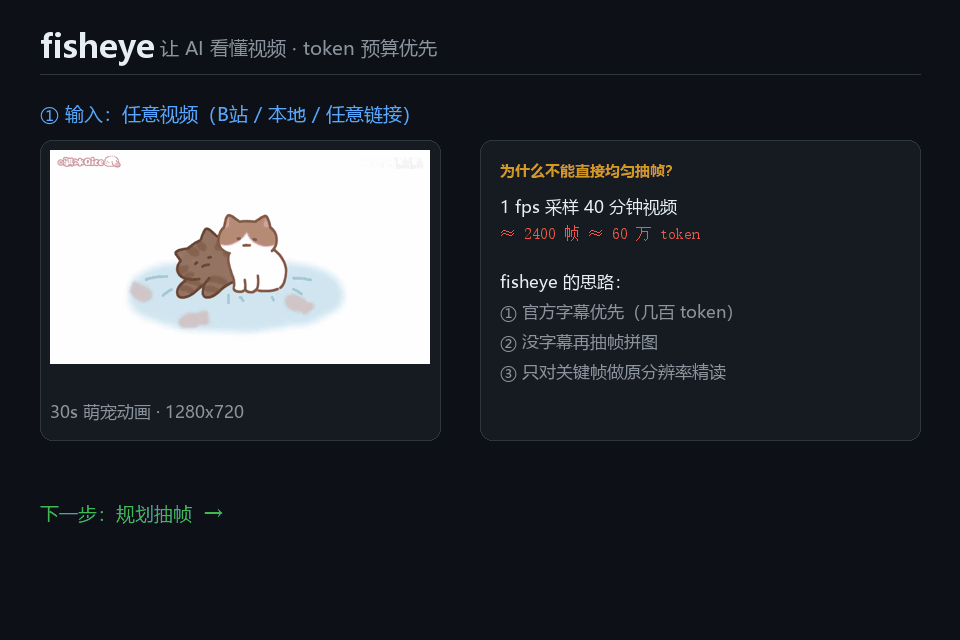

# fisheye · tokencut

[English](./README.en.md) | [中文](./README.md)

> 给 AI 按 token 预算看懂视频——像 tokencut 一样把视频的 token 开销剪下来，而不是每 10 秒抓一帧。

一个命令行工具：**在 token 预算内，尽可能看懂一条视频**——不管它来自 B 站、本地文件，还是任意 URL。

```bash
node fisheye.mjs auto BV1xxx --budget 20000          # B 站
node fisheye.mjs auto video.mp4 --budget 20000       # 本地文件
node fisheye.mjs auto https://... --budget 20000     # 任意 URL（yt-dlp）
```

一个 `auto` 命令通吃多平台，自动识别输入类型，走对应的平台适配器。

---



## 为什么

给 AI 看视频最朴素的做法是「1 秒 1 帧」。但真实视频不需要每秒一帧——下面是对 5 类真实视频的实测（预算 20000）：

### 实测：不同视频的输入 token（预算 20000）

「输入」= fisheye 交给模型读的证据（字幕 + 拼图 + 精读预留）；「1 fps 基线」= 每秒 1 帧、每帧约 250 token。

| 视频（类型） | 时长 | 官方字幕 | 拼图 | 精读预留 | **输入合计** | 1 fps 基线 | 省 |
|---|---|---|---|---|---|---|---|
| 起床，老婆，亲亲（动画短片） | 30s | 中文 52 | 1×1200 | 2600 | **3,852** | ~7,500 | 2× |
| iPhone Duo 评测（科技） | 130s | 英文 2,288（中译 689） | 2×1200 | 2600 | **7,288** | ~32,500 | 4.5× |
| 《利马》（定格动画） | 856s | 字幕带 139 | 8×1200 | 2600 | **12,339** | ~214,000 | 17× |
| 神奇组织 54（历史解说） | 2255s | 英文 49,757（中译 11,615） | 1×1200 | 2600 | **53,557** | ~563,750 | 11× |
| 旗舰芯片大横评（科技长视频） | 3435s | 中文 18,340 | 1×1200 | 2600 | **22,140** | ~858,750 | 39× |

**字幕轨对成本的影响（同一视频，2255s 历史解说）**

| 读哪条轨 | 字幕 token | + 拼图 1200 + 精读 2600 | 合计 | 是否在 2 万预算内 |
|---|---|---|---|---|
| 英文 AI 字幕（原文） | 49,757 | +3,800 | **53,557** | ❌ 超支 2.7 倍 |
| B 站中文翻译轨 | 11,615 | +3,800 | **15,415** | ✅ 预算内 |

**输出 token**：fisheye 不产出摘要（那是调用方模型的事）——模型读完上述「输入」后写出的摘要约 **300 ~ 800 token**（300~800 字），不占 fisheye 的 token 预算。

**结论**

- 输入 token 由「时长 × 字幕密度」主导；拼图/精读是固定开销
- 同一视频选对字幕轨，成本能差 **3.5 倍**（英文原文 5.4 万 → 中文翻译 1.5 万）
- 相对 1 fps 基线省 **2 ~ 39 倍**（短视频省得少，长视频省得多）

## 核心思路：多路信息源 + 一个闭环

不是所有信息都要用图片读。按「单位 token 的信息量」排序，能省的先省：

| 优先级 | 信息源 | 成本 | 什么时候用 |
|---|---|---|---|
| ① | **官方字幕**（CC 字幕轨，优先 AI 中文字幕） | 几百 ~ 几万 token | 视频有字幕时——文本比图便宜一个数量级 |
| ② | **烧录字幕带**（字幕烧进画面） | ~1000 token | 无官方字幕但画面底部有字幕 |
| ③ | **弹幕热区**（观众反应，B 站） | ~100 token | 找观众最激动的时间点，**画面和字幕都看不出这个** |
| ④ | **画面拼图**（3×3 网格） | 1200~3800 token/张 | 兜底：真正需要看画面时 |
| ⑤ | **语义切分**（话题切换点，可选） | 零 token | 识别视频在哪个时间点换了话题/段落，喂精读建议 |

然后对少数关键点做**精读**（原分辨率单帧），只在那里花大钱。

## 安装

> **推荐交给 agent 装**：把本仓库链接（或这份 README）直接发给你的 AI agent，说一句「装一下 fisheye，装完跑 selftest」即可——安装步骤、依赖探测、失败修复提示都写在 README 和 `selftest` 输出里，agent 能自己走完整个流程；跑完如果有 `[!!]` 项，按提示补依赖再跑一遍就行。
>
> 为什么适合交给 agent：核心零 npm 依赖、`selftest` 会逐项诊断并给出修复命令、错误信息里直接带可执行的下一步。

**前置**：Node.js 18+、ffmpeg

**可选**：Python 3.9+（带 `fastembed` + `ruptures`，用于语义切分的 embedding 增强；不装则自动用纯 JS 词法降级）；whisper.cpp（音频转写）；tesseract（OCR）；yt-dlp（任意 URL）

```bash
# 方式一：npm 全局安装（推荐）
npm i -g @pls-compile-owo/fisheye

# 方式二：从源码
git clone https://github.com/pls-compile-owo/fisheye
cd fisheye
npm link   # 可选：装成全局命令
```

### macOS 安装（Apple Silicon / Intel）

```bash
brew install node ffmpeg python3
brew install whisper-cpp                 # 可选：音频转写（arm64 产物名可能是 whisper-cpp-darwin-arm64，fisheye 按前缀自动发现）
brew install tesseract tesseract-lang    # 可选：OCR
pip3 install --user yt-dlp               # 可选：任意 URL
pip3 install -r semantic/requirements.txt # 可选：语义切分
```

**字幕带检测**：已纯 JS 化（`lib/band.mjs`），零 python / 零 numpy-Pillow，无需任何 Python 依赖。

**语义切分**：默认纯 JS 词法降级（`lib/semantic-core.mjs`，零依赖）；想要 embedding 增强（bge-small-zh-v1.5，更准）才需要 python：

```bash
pip3 install -r semantic/requirements.txt   # fastembed + ruptures + numpy
python3 -c "import fastembed, ruptures"     # 自检用同一解释器验证，缺依赖会降级为纯 JS
```

**解压**：Windows 打的 zip 在 macOS 上可能解出反斜杠命名的坏文件。推荐 `npm i -g`，或下载 `npm pack` 生成的 `.tgz`（POSIX 路径安全）。

### 配置 B 站登录态（只用 B 站时需要）

复制 `credentials.example.json` 为 `credentials.json`，填入三个值：

```json
{
  "sessdata": "<你的 SESSDATA>",
  "bili_jct": "<你的 bili_jct>",
  "buvid3": "<你的 buvid3>"
}
```

获取：浏览器登录 B 站 → F12 → Application → Cookies → `bilibili.com`，复制这三个字段。

> ⚠️ 这个文件已被 `.gitignore` 排除，**永远不要提交**。本地文件 / URL 平台不需要登录态。

### 环境变量

| 变量 | 说明 |
|---|---|
| `FISHEYE_LANG` | CLI 输出语言：`zh`（默认）/ `en` |
| `FISHEYE_TOKENS_PER_GRID` / `FISHEYE_TOKENS_PER_SUBS` / `FISHEYE_TOKENS_PER_FINE` | 单张拼图 / 字幕带 / 精读帧的 token 估算覆盖（默认 1200 / 1000 / 1300） |
| `FISHEYE_TOKEN_MODEL` | 按模型 tokenizer 修正估算：`gpt`（1.0）/ `qwen`（1.35）/ `gemini`（0.8）/ 数字 |
| `FISHEYE_WHISPER` / `FISHEYE_WHISPER_MODEL` | whisper 可执行文件 / 模型（ggml-*.bin，可选） |
| `FISHEYE_HOME` | 数据目录（cache/out 位置，默认项目目录） |
| `SEMANTIC_CLI` / `SEMANTIC_PYTHON` | 语义切分 CLI / 跑它的 Python（默认用随包的 `semantic/cli.py`） |
| `FISHEYE_MIN_SCENE` / `FISHEYE_MAX_PICKS` | 精读几何阈值覆盖：画面变化强度门槛（默认 0.85）/ 最多挑几个点（默认 8） |
| `FISHEYE_TESSERACT` / `FISHEYE_YTDLP` | OCR / yt-dlp 可执行文件路径（可选能力；也查 PATH 与常见安装位置） |
| `FISHEYE_AUTO_AUDIO` | 设为 `0` 时 `auto` 不再自动尝试 whisper 转写（等价 `--no-audio`） |
| `FISHEYE_TRACE` / `FISHEYE_DEBUG` | 调试：`FISHEYE_TRACE=1` 生成 `out/<id>-trace.json`（分阶段耗时）；`FISHEYE_DEBUG=1` 打印错误堆栈 |
| `FFMPEG` / `PYTHON` / `BILI_CRED` | 工具与登录态路径覆盖 |

### 依赖路径（一般不用管）

fisheye 按这个顺序找 ffmpeg / python / 凭证：

```
环境变量（FFMPEG / PYTHON / BILI_CRED）
  → ~/.config/fisheye/config.json
  → 项目目录下的 bin/ 和 credentials.json
  → PATH
```

都找不到时才报错，并直接给出修复命令。也可以手动写配置：

```json
// ~/.config/fisheye/config.json
{
  "ffmpeg": "C:/tools/ffmpeg/bin/ffmpeg.exe",
  "python": "C:/Python312/python.exe",
  "credentials": "D:/secrets/bili.json"
}
```

## 快速开始

```bash
# 1. 先自检（1 秒级，确认依赖/凭证/API 都通）
node fisheye.mjs selftest

# 2. 自动规划并铺网（B 站 / 本地 / URL 都行）
node fisheye.mjs auto BV1ziWP6qENy --budget 20000
node fisheye.mjs auto video.mp4 --budget 20000
node fisheye.mjs auto "https://www.bilibili.com/video/BV1ziWP6qENy" --budget 20000

# 3. 看 out/ 目录里的拼图，或读 manifest 决定要不要精读
node fisheye.mjs refine BV1ziWP6qENy

# 4. 精读：截原分辨率单帧
node fisheye.mjs grab BV1ziWP6qENy 82.5,145.0
```

### 常用参数

```bash
--budget 20000          # token 预算（决定张数上限）
--from 1:30 --to 3:00   # 只看一段
--density 6             # 强制 6 秒/帧（覆盖自动推导）
--no-danmaku-frames     # 弹幕热区不参与铺网取帧
--p 2                   # 多 P 视频的第 2 P
--no-audio              # 无官方字幕时不尝试 whisper 转写
```

## 输出

`auto` 会在 `out/` 生成：

| 文件 | 内容 |
|---|---|
| `<id>-cNN_起-止_3x3.jpg` | 拼图（每格一张画面，从左到右、从上到下按时间排列） |
| `<id>-subs_N行.jpg` | 字幕带（只有字幕区，竖排 N 行） |
| `<id>-official-subs.txt` | 官方字幕全文（带时间戳）；另有 `-official-subs-plain.txt` 纯文本 |
| `<id>-official-subs-translated.txt` | 官方中文字幕（视频有翻译轨时） |
| `<id>-manifest.json` | **结构化索引**：每张图的时间范围、每格时间戳、变化强度、弹幕热区、广告段、`semanticShifts`（语义切换点）、`coverage`（各信号源产物完整性） |

`<id>` 是「文件名安全」的稳定标识：B 站 = BV 号，本地 = 文件 basename，URL = 规范化后的哈希。

终端输出一份「规划报告」，解释每个决策（下面的数字拼自多条视频，只用来看格式）：

```
[比例] 画面 1080x1920 → 拼图 1920x3414，单张约 3793 token
[内容] 显著变化 14 处，变化率 0.13 次/秒
[字幕] 无可用官方字幕，检出烧录字幕带（82%-90%，置信度 0.63）→ 字幕带 1 张
[语义] 切出 3 个话题切换点
[广告段] 弹幕密度低谷 1 段：
       04:40-06:40（120s）疑似广告  密度比全片低 34%  关键词「感谢金主爸爸」
[弹幕] 335 条，观众最激动的时段：
       01:25   34 条  「打破桎梏×8」「翻山覆海×3」
[密度] 目标 ≤13s/帧（按变化率推导）
[张数] 密度需要 1 张，预算允许 4 张 → 采用 1 张
[取帧] 00:00-01:49  阈值 0.3，8/9 帧吸附
[拼图 1/1] 00:00-01:49  9 帧 → BVxxx-c00_0000-0109_3x3.jpg
[精读建议] 2 个时间点（几何 1 + 弹幕 1）：
       00:27  弹幕热区  —— 弹幕热区 19 条
```

## 命令

| 命令 | 作用 |
|---|---|
| `auto <BV\|文件\|URL>` | 推荐入口：自动识别平台 → 规划密度/张数/字幕策略 → 铺网 |
| `grid <BV>` | 只铺网（`--chunk` 秒/段、`--grid` 如 3x3） |
| `subs <BV>` | 只生成字幕带（`--count` 行数、`--band auto\|0.22`） |
| `refine <BV>` | 挑出值得精读的时间点，**并直接截好原图**（模板 / 决策文件 / 几何兜底） |
| `grab <BV> <t1,t2>` | 按时间点截原分辨率单帧 |
| `local <视频文件>` | 本地视频快捷抽图（均匀抽帧拼一张图）；加 `--smart` 走完整采集（等价 `auto <文件>`） |
| `transcribe <BV>` | 音频转写（whisper.cpp，`--lang zh`） |
| `ocr <图片>` | OCR 识别图片文字（tesseract，`--lang chi_sim+eng`） |
| `url <链接>` | URL 快捷抽图；加 `--smart` 走完整采集（等价 `auto <链接>`） |
| `batch <清单文件\|条目...>` | 批量处理（`--concurrency N` 并发） |
| `clean [--target cache\|out\|all] [--yes]` | 清理缓存/产物（默认 dry-run） |
| `selftest [--deep]` | 自检：依赖 / 平台适配器 / API / OCR / 转写 / yt-dlp / 语义 / 缓存 / 磁盘 |

> `grid` / `subs` / `refine` / `grab` 要求 `cache/<id>.mp4` 已存在——第一次用请先跑 `auto`（它会下载）。

### 参数范围

| 参数 | 范围 | 默认 |
|---|---|---|
| `--budget` | 2000 ~ 200000 | 20000 |
| `--density` | 0.5 ~ 60（秒/帧） | 按变化率自动 |
| `--p` | 1 ~ 200 | 1 |
| `--chunk`（grid） | 1 ~ 3600（秒） | 按张数算 |
| `--count`（subs） | 1 ~ 50（行） | 自动 |
| `--grid`（grid） | 行列各 1 ~ 9 | 3x3 |
| `--band`（subs） | 0 ~ 0.6（相对高度） | auto |
| `--concurrency`（batch） | 1 ~ 8 | 1 |

### refine 的三种挑点方式

| 方式 | 依据 | 成本 |
|---|---|---|
| `--template` | 生成模板，让模型看拼图后填「哪格看不清」 | 已付（看图时） |
| `--decisions <file>` | 按模型的结构化判断截帧 | 已付 |
| 无参数 | **几何兜底**：场景变化强度 ≥0.85 + 弹幕热区 | 每个选中点 1300 token |

> `refine` 列完点会直接执行截帧。想先只看建议，用 `refine --template`——它只写模板，不截帧。

> 几何规则只能找「画面变化剧烈」，找不出「有文字」——后者必须真的看图。这是设计边界，不是 bug。

## 平台适配器

fisheye 核心不认识任何具体平台。每个平台是一个「适配器」，遵循统一契约（`meta` / `media` / `subtitles` / `danmaku` / `adDetector`）：

| 适配器 | 输入 | 能力 |
|---|---|---|
| `bilibili` | BV 号 | 官方字幕 + 弹幕 + 下载 + 广告识别（弹幕族 + 字幕关键词） |
| `local` | 本地文件路径 | 快速抽图；`--smart` 走完整采集（转写/字幕带/广告/语义） |
| `url` | http(s) 链接 | yt-dlp 下载，其余同本地 |

加平台 = 照 `lib/platforms/_template/` 抄一个目录 + 注册表加一行 import，不碰核心。**静态注册 + 目录约定**（不是热插拔）：fisheye 是本地 CLI，平台内置随包发布。

## 可调参数与扩展点

fisheye 的「判断」都有参数，按你的平台/模型/素材调：

### 广告检测（信号源可插拔）

广告识别已拆成可注册的**信号源**（`lib/signals/`）：弹幕族五路 + 台词族两路，按 `primary`（主信号）/`secondary`（补充）/`subtitle`（台词族）分组编排。每个平台适配器用 `adDetector` 声明「开哪些信号 + 用什么关键词」。

| 信号 | 分组 | 含义 |
|---|---|---|
| `danmaku-density` | primary | 弹幕密度低谷（观众跳过 = 广告） |
| `danmaku-keywords` | primary | 广告关键词群聚 |
| `mark` | secondary | 数字打点（"1407" = 14:07 广告结束） |
| `head` | secondary | 片头口播广告 |
| `buy` | secondary | 购买类话术回溯 |
| `sub-keywords` | subtitle | 字幕/转写里的购买词（不依赖弹幕） |
| `sub-patterns` | subtitle | 字幕/转写里的精确句式（"点击下方链接"） |

```js
// 内置七路，默认开六路（弹幕族 + 字幕关键词）
adDetector: {
  keywords: DEFAULT_KEYWORDS,               // 正则对象 { ad, strong, mark, buy, sub, pattern }
  signals: ['danmaku-density', 'danmaku-keywords', 'mark', 'head', 'buy', 'sub-keywords'],
}
```

无弹幕平台（本地/URL）自动开台词族两路（`sub-keywords`/`sub-patterns`），数据来自 whisper 转写的带时间戳台词。

加新信号 = 在 `lib/signals/` 加一个文件 + 在 `AD_SIGNALS` 注册一行 + 平台在 `signals` 数组声明。完全自定义检测则直接给 `adDetector.detect` 函数（`({ danmaku, duration, subtitles, transcript }) => [{ from, to, confidence, ... }]`）。

调参建议：先用 2~3 条真实视频标真值，再调关键词/信号；误报多就关掉弱信号，漏报多就加平台专属词（数字打点最有效）。

### 弹幕过滤（自定义黑话与引流词）

`danmaku-filter.mjs` 负责剔除广告引流、无意义刷屏。规则是「关键词表 + 句式」：

- 改 `danmaku-filter.mjs` 里的 `AD_RULES`（广告引流词表）加你平台的黑话；噪声判定走 `spamReason()`（纯符号/复读/无意义短句）
- 过滤规则有独立测试：`node test-danmaku-filter.js`（51 条用例）
- `--no-danmaku-frames` 可让弹幕只做「热区/广告」判断，不参与取帧

### 预算模型（按你的 tokenizer 校准）

token 估算按「信息源单价」算，可逐项覆盖：

| 常量 | 默认 | 说明 |
|---|---|---|
| `FISHEYE_TOKENS_PER_GRID` | 1200 | 一张 3×3 拼图 |
| `FISHEYE_TOKENS_PER_SUBS` | 1000 | 一张字幕带 |
| `FISHEYE_TOKENS_PER_FINE` | 1300 | 一个精读帧 |
| `FISHEYE_TOKEN_MODEL` | 1.0 | 模型系数（`gpt` 1.0 / `qwen` 1.35 / `gemini` 0.8 / 自定义数字） |

拼图单价还会按画面面积修正（竖屏是横屏的 ~3 倍），所以同样 12 张，竖屏视频会先触到预算上限。

### 抽帧密度（手动或自适应）

- 默认：按内容变化率推导（0.05~2/秒 → 4/6/9/13 秒一帧）
- `--density N`：强制 N 秒/帧（0.5~60）
- 硬上限 `MAX_GRIDS = 12` 张（防长视频无限膨胀）
- 预算不足时自动降级并在日志说明（"密度需要 20 张，预算允许 3 张 → 采用 3 张"）

### 语义切分（接你自己的模型）

语义模块是**独立外部 CLI**，可以整个替换：

```bash
SEMANTIC_CLI=/path/to/my-semantic-cli.py SEMANTIC_PYTHON=/path/to/python fisheye auto BV1xxx
```

契约（见 `semantic/cli.py` 头部）：

```
输入:  stdin 或第一个参数为 JSON 文件：[{ "t": 秒, "text": "台词" }, ...]
调用:  python cli.py <input.json> [--n-bkps 5]
输出:  stdout JSON { "segments": [{ "t": 秒, "confidence": 0~1, "signals": [...] }],
                     "suggestions": [{ "t": 秒, "reason": "...", "confidence": 0~1, "source": "...", "kind": "..." }] }
```

随包参考实现用 `fastembed`（bge-small-zh）+ `ruptures` 做 embedding 相似度变点检测，零 token、纯 CPU。装好依赖后 `auto` 自动启用 embedding 增强；没有依赖时**降级为纯 JS 词法切分**（`lib/semantic-core.mjs`，char-bigram 漂移），语义区分度弱于 embedding 但仍能切出明显的话题切换。

### 精读阈值（字幕糊判定）

- `MIN_READABLE_SUBS_PX = 12`：拼图里字幕高度低于 12px 判定「必然糊」→ 建议精读
- 精读最多返回 8 个点（按强度/热区排序）
- 字幕已覆盖（官方字幕/转写）时不再建议为「字幕糊」精读

## 断点续跑

长视频中断后，重跑同样命令会提示可复用产物：

```bash
node fisheye.mjs auto BV1xxx --budget 20000 --resume   # 跳过已抽帧阶段，复用拼图
node fisheye.mjs auto BV1xxx --budget 20000 --force    # 强制全部重跑
```

manifest 带 `version` 字段做格式校验，旧产物自动兼容；格式过新的 manifest 会明确报「请升级 fisheye」而不是静默解析错。

## 可选能力

### 本地视频

```bash
# 快速抽图：均匀抽帧拼一张图（最轻量，不付字幕/转写/语义的成本）
node fisheye.mjs local <视频文件> [--grid 3x3] [--from 30] [--to 90]

# 完整采集：等价 auto——多路信号 + 字幕带 + 转写 + 广告识别 + 语义切分
node fisheye.mjs local <视频文件> --smart
node fisheye.mjs auto <视频文件>
```

不依赖 B站 登录与字幕。`local`（不带 `--smart`）只是 ffmpeg 解析时长 → 按 grid 等间隔抽帧拼图 → 输出 `SHEET: <拼图路径>`；`--smart` 或 `auto` 才走完整采集——无官方字幕时自动 whisper 转写（口播/播客类），转写不可用则检测烧录字幕带，转写台词还会喂广告识别与语义切分。适合 mp4/mkv/avi/mov/webm。

### 音频转写（whisper.cpp）

```bash
node fisheye.mjs transcribe BV1xxx --lang zh
```

模型放到项目 `bin/` 或任意目录，用 `FISHEYE_WHISPER_MODEL` 指定；转写文本落 `out/<id>-audio-transcript.txt`。

> **默认策略**：`auto` 发现无官方字幕时会自动尝试转写；转写文本作为台词源，跳过烧录字幕带。不想用加 `--no-audio` 或设 `FISHEYE_AUTO_AUDIO=0`。

### OCR（tesseract）

```bash
node fisheye.mjs ocr screenshot.png [--lang chi_sim+eng]
```

自动探测 `FISHEYE_TESSERACT` → PATH → 常见安装路径；语言包缺 `chi_sim` 时自动降级到 `eng`。结果落 `out/<图片名>.ocr.txt`。

### 任意平台视频（URL / yt-dlp）

```bash
node fisheye.mjs auto "https://www.youtube.com/watch?v=xxx"
```

下载（yt-dlp）→ 自动走本地视频流程。URL 会先「规范化」（去掉时间戳/分享参数）再哈希做 id，保证断点续跑稳定。

### 批量处理

```bash
node fisheye.mjs batch list.txt --concurrency 2      # 清单文件（每行一个 BV/路径/URL，# 注释）
node fisheye.mjs batch BV1xxx BV2xxx "C:\videos\a.mp4"
```

每一项按类型自动分派：BV → bilibili、路径 → local、链接 → url。失败不中断，最后汇总。

### 清理

```bash
node fisheye.mjs clean                    # 预览将清理的缓存/产物（dry-run）
node fisheye.mjs clean --target out --yes # 实际删除 out/
```

## 自检

```bash
node fisheye.mjs selftest        # 快速检查依赖 / 平台适配器 / API / 可选组件 / 磁盘
node fisheye.mjs selftest --deep # 额外做抽帧 + 字幕带 + OCR + 转写 + 语义实测
```

| 类别 | 检查内容 |
|---|---|
| 基础 | Node 版本、ffmpeg、字幕带检测（纯 JS，零 python） |
| 环境 | 输出目录可写、缓存、磁盘剩余 |
| 平台适配器 | 遍历注册表：B 站凭证 / 视频 API / 弹幕 API / 官方字幕 API |
| 可选组件 | 音频转写、OCR、yt-dlp、语义切分 |
| `--deep` | 抽帧 / 字幕带 / OCR 样图 / 静音转写 / 语义 3 行切分（真跑样例，不只验二进制在不在） |

输出标记：`[OK]` 通过、`[--]` 跳过（可选依赖未装/无数据）、`[!!]` 失败。失败时末尾打印修复提示。

## MCP server（可选）

`mcp-video-server.js` 把 fisheye 包装成 [MCP](https://modelcontextprotocol.io/) 工具，让支持 MCP 的 agent 环境（DSH / Claude Code / Cursor 等）不必自己拼命令行就能看视频。

这是**可选组件**：fisheye 核心保持零依赖，不装下面两个 npm 包也能正常用 `auto` 等命令。

```bash
# 在 fisheye 目录（含 fisheye.mjs 的那层）里执行
npm i @modelcontextprotocol/sdk zod
```

配置（Claude Code 写进 `.mcp.json`；DSH 用同样的 `mcpServers` 结构）：

```json
{
  "mcpServers": {
    "fisheye": {
      "command": "node",
      "args": ["C:/path/to/fisheye/mcp-video-server.js"]
    }
  }
}
```

| 工具 | 作用 | 参数 |
|---|---|---|
| `vwatch_scan` | 快速扫一眼：开头一段抽帧拼成九宫格，**直接返回画面** | `bvid`、`grid` |
| `vwatch_deep` | 深入看懂：按 token 预算抽帧 + 官方字幕 → 独立 headless 会话读完 → **只返回完整复述** | `bvid`、`from`、`to`、`page`、`budget` |

> 工具名沿用旧名 `vwatch_*`，以免破坏已有 MCP 配置。

## DSH 插件（可选）

DSH（DeepSeek Harness）用户可以直接装插件版，把 fisheye 注册成 agent 的 `video_understand` 工具：

```bash
dsh plugin --profile web add @pls-compile-owo/dsh-fisheye
```

也可以本地安装本仓库的 `dsh-plugin/` 目录（插件 → 添加插件 → 选目录）。插件只负责「看视频」，产出拼图/字幕/弹幕证据，摘要交给调用方模型或下游插件——适合作为其他视频理解插件的**上游预处理模块**。

## 它怎么工作

```
① 解析输入 → 平台适配器（BV / 本地文件 / URL）
② 取元信息（分P / 时长 / 分辨率）
③ 时间范围（--from/--to）
④ 画面比例 → 单张拼图 token 估算（竖屏是横屏的 3 倍！）
⑤ 场景检测（ffmpeg 一次解码，320p）→ 内容变化率
⑥ 字幕决策：官方字幕 > 转写 > 烧录字幕带 > 只看画面
⑦ 弹幕（B 站）：热区（观众高光）+ 广告段（多信号源）
⑧ 语义切分（可选）：纯 JS 词法（char-bigram）或 embedding 增强 → 话题切换点
⑨ 密度决策：变化率 → 目标帧间隔（4/6/9/13 秒）
⑩ 张数决策：密度需求 vs 预算封顶（硬上限 12 张）
⑪ 铺网：分段 → 取帧（等间隔骨架 + 吸附画面变化点）→ 拼图
⑫ 精读建议：场景变化 + 弹幕热区 + 语义切换点，避开广告段
```

### 几个关键设计

**为什么取帧是「等间隔 + 吸附」而不是纯关键帧？**
只等间隔 → 漏掉只闪一两秒的关键画面；只吸附关键帧 → 转场全挤在开头。混合：等间隔保覆盖，每个基准点在 ±半格内吸附到画面变化点。

**为什么字幕带不用 OCR？**
中文 OCR 在低分辨率、花哨排版下错误率高。把字幕带切下来交给多模态模型直接读更准，成本也接近。代价是一行字幕占一张图的宽度，所以只切字幕区竖排。

**为什么弹幕能参与取帧？**
B 站弹幕密度本身就是内容信号。实测一条 40 分钟视频：广告段弹幕密度只有全片的 **31%**（观众跳过），观众最激动处是 3~5 倍。

**为什么广告段可以不占帧？**
把广告段从时间轴「压缩掉」，剩余有效时间重新均分——帧数不变，内容密度提升。实测：跳过 118 秒广告后，平均帧间隔从 22.1 秒降到 **8.3 秒**。

**为什么语义切分不靠大模型？**
字幕/转写文本做相似度检测（默认纯 JS char-bigram 漂移，有 python 时换 embedding 增强），零 token、纯 CPU。语义切换点作为「结构信号」喂精读建议，不融合进几何（几何是「内容信号」，语义是「结构信号」）。

## 性能基准

> 实测环境：Windows 11 / Intel i5-12500H（12C16T）/ 16 GB / NVMe SSD。
> 测试视频：B 站 37 分钟（2255s，1080p，281 MB），**缓存命中、不含下载**。

| 阶段 | 耗时 | 说明 |
|---|---|---|
| **auto 全流程** | **75 ~ 83 秒** | 场景检测 + 字幕/弹幕 API + 语义 + 拼图 |
| ├ 场景检测（瓶颈） | ~72 秒 | ffmpeg 全片 320p 解码，占全流程 ~95% |
| ├ 字幕 / 弹幕 API | ~1 ~ 2 秒 | 取决于网络与 B 站 响应 |
| ├ 语义切分（纯 JS 词法） | ~0.2 秒 | 1026 行字幕，CPU 单核 |
| └ 拼图 1 张（9 帧） | ~1 秒 | ffmpeg 单帧截取 |
| grid（全片 38 张，含场景检测） | 140 秒 | 342 帧截图 |
| subs（字幕带检测） | 5.6 秒 | 24 帧采样 |
| ocr（单张图片） | 0.5 秒 | tesseract |
| 下载 281 MB | 227 秒 | 网络相关，不算处理耗时 |
| **峰值内存** | **142 MB**（其中 ffmpeg 85 MB） | 进程树 RSS |

**结论**：40 分钟视频的处理成本几乎全在「场景检测」——为判断内容变化率做一次全片 320p 解码。抽帧、拼图、语义、字幕都是秒级。想更快可以先用 `--from/--to` 只处理关心的区间。

### 不同硬件（未实测，不编数）

本机之外没有实测数据。按重要性排序，影响耗时的因素：

1. **CPU 与解码性能**——场景检测是 ffmpeg 全片解码，主要吃 CPU 单核；多核帮助有限
2. **网络**——下载 281 MB 视频时，B 站 限速往往是最大耗时（本机 227 秒）
3. **内存**——几乎不是瓶颈（峰值 ~150 MB）；SSD 只影响缓存视频的顺序读

想在自己的机器（M1 / Intel / 云服务器）上测：

```bash
# 单项：场景检测（最能代表机器差异）
ffmpeg -hide_banner -i video.mp4 -vf "scale=320:-2,select='gt(scene,0.05)',metadata=print:file=/tmp/s.txt" -an -f null -

# 全流程
node fisheye.mjs auto BV1xxx --budget 20000
```

把结果贴到 Issue，会更新这张表。
## 已知限制

- **能力随平台变化**：B 站最全（字幕+弹幕+广告）；本地/URL 无弹幕，广告识别与语义切分都靠 whisper 转写的带时间戳台词；画面 OCR 视觉族仍未做
- **依赖登录态（仅 B 站）**：部分视频的字幕/播放地址需要 cookies
- **语义切分只对有字幕/对白的视频有效**：无官方字幕且转写不可用时自动跳过
- **广告段检测对 B 站（弹幕）最强**：无弹幕平台的台词族是补强
- **长视频成本高**：40 分钟中文视频官方字幕约 1.2 万 token（英文 AI 字幕更多，可到 5 万）
- **B 站接口会变**：`selftest` 能帮你快速定位是哪个环节挂了

### 调试 trace（`FISHEYE_TRACE=1`）

排查「慢在哪 / 为什么跳过某个信号源」时打开 trace：

```bash
FISHEYE_TRACE=1 node fisheye.mjs auto BV1xxx --budget 20000
# → out/<id>-trace.json：每个采集阶段的耗时（download / scene-detect / subtitles / transcribe /
#   subtitle-band / danmaku / ad-detection / semantic），失败阶段带 error 字段
```

trace 只写文件与 stderr，不污染 stdout 的结果输出；不开启时零开销。配合 `FISHEYE_DEBUG=1` 可在致命错误时打印堆栈。

### 测试

```bash
node --test --test-concurrency=1 test/          # 单元 + golden + 集成 + 退化场景（211 用例）
node --test test/integration.test.mjs           # 真实 CLI 端到端（local / --smart + trace / selftest / clean）
node --test test/degradation.test.mjs           # 退化场景：无 ffmpeg / 坏文件 / 坏参数 / 坏 manifest
```

退化场景用例断言的是「清晰报错 + 非零退出码 + 不抛未捕获栈」——防止缺依赖或坏输入时静默假成功。
## 开发

```bash
node --test test/                       # 单元测试 + golden 验收集（离线可跑）
node test-danmaku-filter.js              # 弹幕过滤规则测试（51 条用例）
node fisheye.mjs selftest --deep         # 含抽帧/字幕带/OCR/转写/语义实测的自检
```

当前：**211 个测试**（208 通过 + 3 跳过）+ **51 条弹幕过滤用例**；广告检测有 **8 条人工标注真值**视频。

项目结构：

| 文件 | 职责 |
|---|---|
| `fisheye.mjs` | CLI 入口（参数解析 / 输入解析 / 命令分发） |
| `lib/platforms/` | 平台适配器（`bilibili` / `local` / `url` + `_template` + `_probe` 时长探测 + `index.mjs` 注册表） |
| `lib/env.mjs` | 路径与依赖解析（ffmpeg / 语义 python / 凭证 / 配置） |
| `lib/i18n.mjs` | CLI 中英双语文案 |
| `lib/util.mjs` | 时间格式化 / 参数校验 / 文件头探测 |
| `lib/proc.mjs` | 进程探测共用工具（三个可选能力 audio/ocr/ytdlp 共用） |
| `lib/retry.mjs` | B站 API 重试（指数退避 + 抖动） |
| `lib/resume.mjs` | 断点续跑（manifest 读写 / 阶段记录） |
| `lib/progress.mjs` | 进度辅助（分段抽帧 / 阶段计时） |
| `lib/bili.mjs` | B站纯函数 + API（视频信息 / WBI 签名 / 官方字幕 / 弹幕） |
| `lib/frame.mjs` | 抽帧与时间点选择（场景检测 / 取帧计划 / 单帧截取） |
| `lib/band.mjs` | 字幕带定位（纯 JS，ffmpeg PGM 灰度 → 梯度/分位/峰值，零 python） |
| `lib/danmaku.mjs` | 弹幕热区摘要 + 广告检测入口 re-export（实现在 `lib/signals/`） |
| `lib/signals/` | 广告信号源（弹幕族五路 + 台词族两路，可插拔注册表 + 编排器） |
| `lib/semantic.mjs` | 语义切分能力探测（embedding 增强 + 纯 JS 兜底） |
| `lib/semantic-core.mjs` | 语义切分纯 JS 核心（char-bigram 词法漂移 + top-k 峰值） |
| `lib/audio.mjs` | 音频转写（whisper.cpp 探测 + 调用） |
| `lib/ocr.mjs` | OCR（tesseract 探测 + 调用） |
| `lib/ytdlp.mjs` | yt-dlp 探测 + 视频下载 |
| `lib/batch.mjs` | 批量处理（并发编排） |
| `lib/budget.mjs` | token 预算估算（单价 + 模型系数） |
| `lib/collect.mjs` | 采集层（下载/元信息/字幕/弹幕/广告/语义 → ctx） |
| `lib/planner.mjs` | 规划（密度/张数/预算） |
| `lib/executor.mjs` | 精读建议（几何挑点 + 弹幕热区 + 语义切换点合并） |
| `lib/stages.mjs` | 子命令编排（auto / grid / subs / refine / grab / local / ...） |
| `lib/selftest.mjs` | 自检实现 |
| `dsh-plugin/` | DSH 插件包装（`video_understand` 工具） |
| `semantic/cli.py` | 语义切分参考实现（fastembed + ruptures） |
| `test/` | `node:test` 单元测试；CI 见 `.github/workflows/ci.yml` |

更多文档：

- [`docs/DESIGN.md`](docs/DESIGN.md) — 设计决策与取舍
- [`docs/CONFIG.md`](docs/CONFIG.md) — 配置与故障排查
- [`docs/REVIEW.md`](docs/REVIEW.md) — 验证流程与评审清单

## 合规

本项目仅用于**个人学习与研究**：

- 请遵守各平台《用户协议》，勿商用、勿批量抓取
- 登录态 cookies 属于你的账号凭据，**泄露可能导致账号风险**
- 视频与字幕版权归原作者与平台所有，工具输出仅供个人参考

## 致谢

### 灵感来源与代码来源

fisheye 最初作为一个 DSH 插件内部的视频理解命令开发，之后独立为 CLI。
设计思路（官方字幕优先、按变化率选密度、精读闭环）与部分目录约定参考了 **SurfCore**
（QQ ↔ DeepSeek Harness 桥接与 B站 工具插件，MIT License，
Copyright (c) 2026 Derpyu520 and qq-bridge / QSH contributors）。

`danmaku-filter.mjs`（弹幕垃圾过滤）衍生自 SurfCore 中的同名模块，按 MIT 许可保留原版权声明，
详见 [LICENSE](./LICENSE) 末尾的第三方代码声明。

### 第三方依赖

| 依赖 | 用途 | 许可 |
|---|---|---|
| [ffmpeg](https://ffmpeg.org/) | 抽帧、拼图、字幕带切片 | LGPL/GPL |
| [whisper.cpp](https://github.com/ggml-org/whisper.cpp) | 音频转写（可选） | MIT |
| [Tesseract OCR](https://github.com/tesseract-ocr/tesseract) | 图片文字识别（可选） | Apache-2.0 |
| [yt-dlp](https://github.com/yt-dlp/yt-dlp) | 任意平台视频下载（可选） | Unlicense |
| [fastembed](https://github.com/qdrant/fastembed) + [ruptures](https://github.com/deepcharles/ruptures) | 语义切分 embedding 增强（可选） | Apache-2.0 / BSD-2 |

### 思想来源

「先粗看再精读」不是新想法，学术上叫 *hierarchical / agentic video understanding*。这个工具的价值不在提出新方法，而在把「token 预算」当成一等约束来工程设计——这一点在开源生态里反而少见，大多数方案默认算力免费。

## License

MIT
